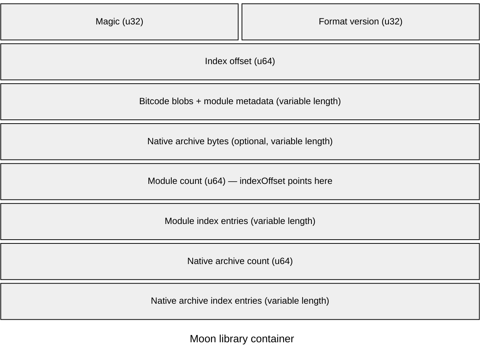

# Moon Library Format

Part of the [Sun ABI draft](/abi). Requirements are proposed, not guarantees of
current releases. **MUST**, **MUST NOT**, and **SHOULD** express draft requirements.
Unresolved decisions must be completed before stabilization.

## Role of a Moon bundle

A `.moon` file packages compiled code with the declarations needed to import it.
The container format, interface schema, generic semantics, and machine ABI are
separate contracts. Their compatibility requirements are defined in the
[compatibility model](/abi/compatibility).

This page distinguishes the current implementation from proposed durable format
rules. It is not yet a complete byte-level specification for an independent
reader or writer.

## Current container structure

The implementation is defined by `include/moon_bundling/moon.h` and
`src/moon_bundling/moon.cpp`. The writer emits the following logical structure:

The header fields show their integer widths. Each variable-length region is
compressed into one schematic row; its drawn width is not its stored size.
Bit labels are hidden because rows after the header do not represent fixed file
offsets. Empty entry lists occupy no bytes, while their count fields remain.
The header's `indexOffset` locates the module count at the start of the index.
This diagram shows record order, not a portable byte-order or padding guarantee.

Multiple module entries may point to the same bitcode blob. Data regions must
therefore not be assumed to have one owner or to occur once per module.

| Record | Current contents |
| --- | --- |
| Header | `uint32` magic value `0x53554E4C`, `uint32` format version, `uint64` index offset |
| Module index | `uint64` entry count followed by module entries |
| Module entry | `uint32` key byte length, key bytes, then `uint64` bitcode offset, bitcode size, metadata offset, and metadata size |
| Native archive index | `uint64` entry count followed by archive entries |
| Archive entry | `uint32` hash byte length, hash bytes, `uint32` name byte length, name bytes, then `uint64` offset and size |

Offsets are positions from the start of the file. Sizes describe byte ranges.
The current writer writes the header as a native C++ structure and index integers
using their native in-memory representation. Consequently this implementation
must not be mistaken for a canonical, host-independent wire encoding. The magic
is an integer constant; its displayed hexadecimal spelling does not define the
order of bytes in the file.

The reader currently requires an exact match with `MoonHeader::VERSION`.
That single check is not the separate compatibility negotiation proposed here.

## Module metadata

`include/moon_bundling/moon.proto` defines the current protobuf metadata, reusing
AST schemas. It carries module names and visibility, declaration records and
portable references, artifact identities, dependencies, target triple, static
initialization order, declarations, retained generic bodies, globals, and C
binding assertions.

Ordinary compiled function bodies are not exported as generic source bodies.
Global initializers are omitted from declaration metadata; their compiled storage
and initialization code reside in the payload. Private declarations may still
be needed by generic bodies and must preserve their identities and visibility.

A protobuf reader accepting a field is not evidence that it understands the
field's semantics. Unknown required language features MUST be rejected under the
proposed [generic semantics contract](/abi/generics).

## Dependency and native archive handling

Current bundles include linked bitcode from compiled dependencies. The dependency
list is not a dynamic-loader instruction to replace that code with the newest
available library. Exact referenced declaration identities remain significant
when importing metadata and specializing generic bodies.

Native static archives are carried with an archive-set identity. Their symbols
are isolated using that identity, and the same carried archive set can be
deduplicated. This isolates names; it does not establish compatible C runtimes,
allocation families, process-wide state, or platform requirements. Those remain
part of the [runtime](/abi/runtime) and [ownership](/abi/ownership) contracts.

## Compiler provenance and contract manifests

The proposed format MUST retain the producing compiler build identity and
ordering metadata separately from its generated compatibility requirements.
It MUST preserve provenance and requirements for carried dependencies rather
than assigning the outer bundle's compiler identity to all embedded code.

The [automatic compatibility procedure](/abi/compatibility#automatic-compatibility-decision)
compares those requirements with the consumer's available implementations.
Older compatible dependencies produce warnings. Incompatible dependencies, or
those whose compatibility cannot be established, stop compilation with an error.
A compiler version string or manually assigned ABI number cannot authorize an
import. The manifest stores [computed contract hashes](/abi/compatibility#computed-abi-hashes),
their canonical descriptions, and an aggregate requirements hash. Compiler
provenance and artifact identity are separate from those hashes. The manifest's
exact binary encoding remains unresolved.

## Proposed encoding requirements

A stable container revision MUST define an explicit wire encoding independent of
C++ structure padding and producer host byte order. The proposed direction is
fixed-width little-endian container integers, byte-counted UTF-8 textual fields,
and explicitly defined offsets. This is a proposal for a future version, not a
claim that current files already conform. Target payload byte order remains a
separate property.

The final format MUST specify header bytes, section identifiers, required versus
optional sections, index encoding, allowed shared ranges, string encoding,
resource limits, and integrity checks. It MUST reserve a mechanism for required
capabilities without treating every unknown field as mandatory.

A reader MUST validate lengths and counts before allocation, check ranges without
integer overflow, reject truncation and invalid references, and reject conflicting
duplicate identities. Shared bitcode ranges are permitted; arbitrary overlap
between unrelated records MUST NOT be accepted implicitly. Exact overlap and
uniqueness rules remain to be specified.

An artifact's build-input identity MUST NOT be confused with a checksum of its
serialized bytes. The format must define any payload-integrity digests separately.
A digest is not proof that an untrusted producer honored Sun's safety rules.

## Import validation order

The proposed reader performs these checks before generated code uses the bundle:

1. Validate the header, container version, index bounds, and record encoding.
2. Decode supported metadata and reject missing required capabilities.
3. Validate declaration references, exact dependencies, and duplicate identities.
4. Check target, ABI, generic semantics, runtime, and payload requirements.
5. Validate imported layout and signature contracts before lowering dependent code.
6. Load or link supported payloads and specialize supported generic bodies.

These are logical validation stages; lazy loading is permitted only when it
preserves the requirement to reject incompatible data before use. Merely parsing
a container MUST NOT run its startup code.

## Format decisions still required

- Exact byte-level specification and migration from native header encoding.
- Placement and encoding of separate compatibility requirements.
- Bounds, resource limits, overlap rules, and integrity coverage.
- Whether future bundles carry native Sun objects, optional bitcode, or both.
- Rules for optional sections, older readers, and supported revision lifetimes.
- Versioned interface and generic-body schemas with reference validation.

The [conformance suite](/abi/conformance) must retain historical bundles. Container
tests must additionally cover malformed offsets, overflowing lengths, truncation,
shared blobs, duplicate records, unknown capabilities, and unsupported payloads.

## Compiled payloads

Moon currently carries LLVM bitcode together with declarations and generic
bodies. The initial design may retain that model. Bitcode reader compatibility,
Sun ABI compatibility, and generic semantic compatibility MUST be checked as
separate requirements.

LLVM's backward bitcode compatibility helps newer consumers load older code;
it does not define Sun layouts or permit older readers to consume arbitrary
future bitcode. See the [LLVM compatibility policy](https://llvm.org/docs/DeveloperPolicy.html#ir-backwards-compatibility).

Native objects with optional bitcode are a possible future packaging design.
They would reduce dependence on bitcode readers while preserving the need for
compatible metadata, generic specialization, platform ABI, and runtime services.
No payload-format migration is required by this draft.
