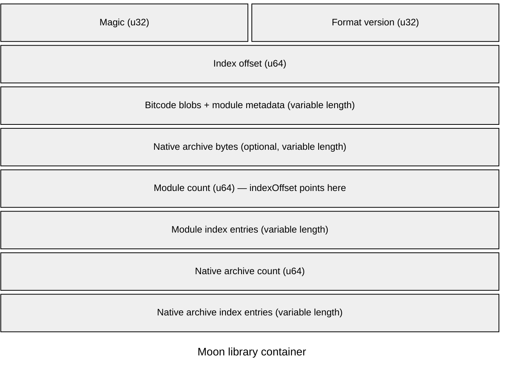

# Moon Library Format

Part of the [Sun ABI draft](/abi). These are proposed requirements, not guarantees
of current releases. Open decisions must be resolved before stabilization.

## Role of a Moon bundle

A `.moon` file packages compiled code with the declarations needed to import it.
The container format, interface schema, generic semantics, and machine ABI are
separate contracts. Their compatibility requirements are defined in the
[compatibility model](/abi/compatibility).

The sections below describe the current format and proposed changes. The draft
does not yet specify every byte needed to implement a reader or writer.

## Current container structure

The implementation is defined by `include/moon_bundling/moon.h` and
`src/moon_bundling/moon.cpp`. The writer emits the following logical structure:

The header fields show their integer widths. Each variable-length region is
compressed into one schematic row; its drawn width is not its stored size.
Bit labels are hidden because rows after the header do not represent fixed file
offsets. Empty entry lists occupy no bytes, while their count fields remain.
The header's `indexOffset` locates the module count at the start of the index.
This diagram shows record order, not a portable byte-order or padding guarantee.

Several module entries can share one bitcode blob; there is not necessarily a
separate blob for each module.

| Record | Current contents |
| --- | --- |
| Header | `uint32` magic value `0x53554E4C`, `uint32` format version, `uint64` index offset |
| Module index | `uint64` entry count followed by module entries |
| Module entry | `uint32` key byte length, key bytes, then `uint64` bitcode offset, bitcode size, metadata offset, and metadata size |
| Native archive index | `uint64` entry count followed by archive entries |
| Archive entry | `uint32` hash byte length, hash bytes, `uint32` name byte length, name bytes, then `uint64` offset and size |

Offsets are positions from the start of the file. Sizes describe byte ranges.
The current writer writes the header as a native C++ structure and index integers
using their native in-memory representation. The resulting encoding
can depend on the host byte order and structure padding. The magic
is an integer constant; its displayed hexadecimal spelling does not define the
order of bytes in the file.

The reader currently requires an exact match with `MoonHeader::VERSION`.
That single check is not the separate compatibility negotiation proposed here.

## Module metadata

`include/moon_bundling/moon.proto` defines the current protobuf metadata, reusing
AST schemas. It carries module names and visibility, declaration records and
portable references, artifact identities, dependencies, target triple, static
initialization order, declarations, retained generic bodies, globals, and C
binding assertions.

Ordinary compiled function bodies are not exported as generic source bodies.
Global initializers are omitted from declaration metadata; their compiled storage
and initialization code reside in the payload. Private declarations may still
be needed by generic bodies and must preserve their identities and visibility.

Reading a protobuf field does not mean the consumer understands its meaning.
The proposed reader checks required language features as well as field encoding;
see [generic semantics](/abi/generics).

## Dependency and native archive handling

Current bundles include linked bitcode from compiled dependencies. The dependency
list is not a dynamic-loader instruction to replace that code with the newest
available library. Exact referenced declaration identities remain significant
when importing metadata and specializing generic bodies.

Native static archives are carried with an archive-set identity. Their symbols
are isolated using that identity, and the same carried archive set can be
deduplicated. This isolates names; it does not establish compatible C runtimes,
allocation families, process-wide state, or platform requirements. Those remain
part of the [runtime](/abi/runtime) and [ownership](/abi/ownership) contracts.

## Compiler provenance and contract manifests

The proposed manifest stores compiler provenance separately from compatibility
contracts. It contains [contract hashes](/abi/compatibility#computed-abi-hashes),
their canonical descriptions, and an aggregate requirements hash. Its binary
encoding is still undecided.

| Subject | Level | Requirement |
| --- | --- | --- |
| Producer metadata | MUST | Store the producer's build identity and ordering metadata separately from generated compatibility requirements. |
| Embedded dependencies | MUST | Preserve each dependency's producer and requirements; do not assign the outer bundle's producer to all embedded code. |

The [compatibility procedure](/abi/compatibility#automatic-compatibility-decision)
checks each requirement against an available implementation. Older compatible
dependencies produce warnings. Incompatible or unverifiable dependencies stop
compilation. A compiler version string or assigned ABI number cannot authorize
an import.

## Proposed encoding requirements

The proposed encoding uses fixed-width little-endian container integers,
byte-counted UTF-8 text, and defined offsets. Current files do not yet follow
this proposal. Target payload byte order is a separate property.

| Subject | Level | Requirement |
| --- | --- | --- |
| Wire encoding | MUST | Define an encoding independent of C++ padding and producer host byte order. |
| Format specification | MUST | Define header bytes, section identifiers, required and optional sections, indexes, shared ranges, strings, resource limits, and integrity checks. |
| Capabilities | MUST | Provide a way to mark required capabilities without making every unknown field mandatory. |
| Language features | MUST | Reject unknown required features under the generic semantics contract. |
| Lengths and counts | MUST | Validate them before allocation. |
| Ranges and references | MUST | Check ranges without integer overflow; reject truncation, invalid references, and conflicting duplicate identities. |
| Overlapping records | MUST NOT | Accept arbitrary overlap between unrelated records. Shared bitcode ranges are allowed; exact overlap rules still need a specification. |
| Artifact identity | MUST NOT | Treat build-input identity as a checksum of serialized bytes. |
| Integrity digests | MUST | Define payload-integrity digests separately from artifact identity. |

A digest does not prove that an untrusted producer followed Sun's safety rules.

## Import validation order

The proposed reader performs these checks before generated code uses the bundle:

1. Validate the header, container version, index bounds, and record encoding.
2. Decode supported metadata and reject missing required capabilities.
3. Validate declaration references, exact dependencies, and duplicate identities.
4. Check target, ABI, generic semantics, runtime, and payload requirements.
5. Validate imported layout and signature contracts before lowering dependent code.
6. Load or link supported payloads and specialize supported generic bodies.

| Subject | Level | Requirement |
| --- | --- | --- |
| Validation timing | MUST | Complete the checks above before generated code uses the bundle. Lazy loading must reject incompatible data before use. |
| Parsing | MUST NOT | Run startup code merely because the container is being parsed. |

## Format decisions still required

- Exact byte-level specification and migration from native header encoding.
- Placement and encoding of separate compatibility requirements.
- Bounds, resource limits, overlap rules, and integrity coverage.
- Whether future bundles carry native Sun objects, optional bitcode, or both.
- Rules for optional sections, older readers, and supported revision lifetimes.
- Versioned interface and generic-body schemas with reference validation.

| Subject | Level | Required tests |
| --- | --- | --- |
| Historical bundles | MUST | Retain old artifacts in the [conformance suite](/abi/conformance). |
| Container validation | MUST | Cover malformed offsets, overflowing lengths, truncation, shared blobs, duplicate records, unknown capabilities, and unsupported payloads. |

## Compiled payloads

Moon currently carries LLVM bitcode, declarations, and generic bodies. The initial
design can keep this model.

| Subject | Level | Requirement |
| --- | --- | --- |
| Payload compatibility | MUST | Check bitcode reader compatibility, Sun ABI compatibility, and generic semantics separately. |

LLVM's backward bitcode compatibility helps newer consumers load older code;
it does not define Sun layouts or permit older readers to consume arbitrary
future bitcode. See the [LLVM compatibility policy](https://llvm.org/docs/DeveloperPolicy.html#ir-backwards-compatibility).

Native objects with optional bitcode are a possible future packaging design.
They would reduce dependence on bitcode readers while preserving the need for
compatible metadata, generic specialization, platform ABI, and runtime services.
No payload-format migration is required by this draft.
